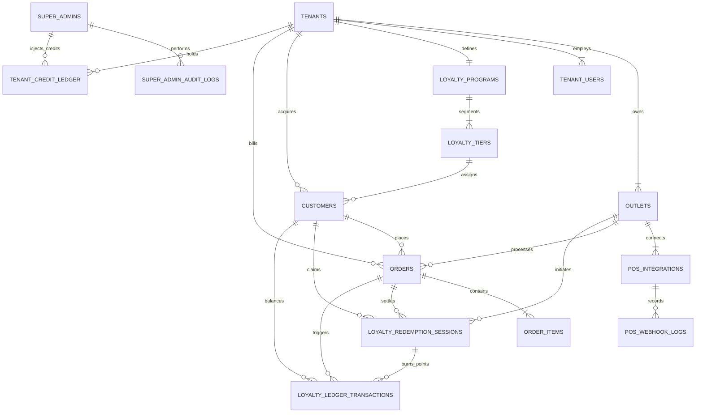

# Yeezy Loyalty Platform - Database Schema & POS Integration Guide

This document specifies the enterprise multi-tenant database architecture, Super Admin controls, and the bidirectional integration engine with **Petpooja** (and other restaurant POS systems).

---

## 🏛️ System Architecture Overview

```
                                 ┌─────────────────────────────────┐
                                 │       SUPER ADMIN PORTAL        │
                                 │  (Tenant Onboarding, Analytics, │
                                 │  Global POS Keys, Audit Logs)   │
                                 └───────────────┬─────────────────┘
                                                 │
                                                 ▼
                        ┌───────────────────────────────────────────────────┐
                        │              MULTI-TENANT ORGANIZATIONS           │
                        │         (Brand / Restaurant Group Level)          │
                        │  - Yeezy Burgers & Shakes                         │
                        │  - Smoke House Deli                               │
                        └─────────┬───────────────────────────────┬─────────┘
                                  │                               │
                                  ▼                               ▼
                 ┌─────────────────────────────────┐   ┌─────────────────────────────────┐
                 │       Outlet 1 (Connaught Pl)   │   │       Outlet 2 (Indiranagar)    │
                 │   Petpooja restID: 'PP_DEL_101' │   │   Petpooja restID: 'PP_BLR_202' │
                 └────────────────┬────────────────┘   └────────────────┬────────────────┘
                                  │                                     │
                                  ▼                                     ▼
                 ┌───────────────────────────────────────────────────────────────┐
                 │                    PETPOOJA POS TERMINALS                     │
                 │  - Cashier enters customer mobile number on billing screen    │
                 │  - Petpooja queries: "Fetch customer & eligible discount"     │
                 │  - Loyalty engine returns: "Points: 340, Discount: ₹340 off"  │
                 │  - Bill settled: Petpooja sends order payload                 │
                 │  - Double-entry ledger credits points & sends WhatsApp bill   │
                 └───────────────────────────────────────────────────────────────┘
```

---

## 📊 Database Entity Relationship Diagram (ERD)



---

## 🔌 Petpooja POS Integration Specifications

Petpooja connects with external loyalty providers via **3 core webhooks/REST endpoints**:

### 1. Customer Lookup & Discount Inquiry API
When the cashier types the diner's phone number on the Petpooja billing screen, Petpooja calls our system.

- **Endpoint**: `POST /api/v1/pos/petpooja/loyalty/inquire`
- **Direction**: Petpooja POS ➔ Yeezy Loyalty Engine
- **Petpooja Inbound Payload**:
```json
{
  "restID": "PP_DEL_101",
  "app_key": "sec_live_9a8f...",
  "customer_phone": "9876543210",
  "customer_name": "Rohan Sharma",
  "order_id": "PP-ORD-88291",
  "table_no": "T-12",
  "bill_amount": 1450.00,
  "discountable_amount": 1350.00
}
```

- **Loyalty Engine Response to Petpooja**:
```json
{
  "status": "success",
  "customer": {
    "name": "Rohan Sharma",
    "tier": "Gold VIP",
    "points_balance": 420.00,
    "points_value_inr": 420.00
  },
  "redemption_offer": {
    "session_token": "red_sess_89f0a21bc9e",
    "is_eligible": true,
    "max_redeemable_points": 420.00,
    "discount_amount": 420.00,
    "min_bill_amount_required": 200.00,
    "max_allowed_discount_pct": 50.0,
    "requires_otp": false,
    "message": "Apply ₹420 discount (burn 420 points)?"
  }
}
```

---

### 2. Discount Claim & Points Lock (Hold)
If the cashier clicks **"Redeem Points"** on Petpooja:
- Points are locked in `loyalty_redemption_sessions` with status `LOCKED_PENDING_PAYMENT` for 15 minutes.
- Prevents race conditions or double-spending if the customer tries to redeem simultaneously at another terminal.

---

### 3. Order Bill Settlement & Points Accrual (Save Order Webhook)
When the bill is finalized and paid on Petpooja:

- **Endpoint**: `POST /api/v1/pos/petpooja/orders/save`
- **Direction**: Petpooja POS ➔ Yeezy Loyalty Engine
- **Inbound Payload from Petpooja**:
```json
{
  "restID": "PP_DEL_101",
  "order_id": "PP-ORD-88291",
  "bill_no": "BILL/2026/10/88291",
  "table_no": "T-12",
  "server_name": "Vikas",
  "customer": {
    "phone": "9876543210",
    "name": "Rohan Sharma"
  },
  "financials": {
    "subtotal": 1450.00,
    "tax": 72.50,
    "service_charge": 0.00,
    "gross_amount": 1522.50,
    "loyalty_discount": 420.00,
    "other_discount": 0.00,
    "net_paid": 1102.50,
    "payment_mode": "UPI"
  },
  "redemption_session_token": "red_sess_89f0a21bc9e",
  "items": [
    { "item_id": "ITEM_101", "name": "Truffle Burger", "qty": 2, "price": 450.00 },
    { "item_id": "ITEM_204", "name": "Belgian Shake", "qty": 1, "price": 250.00 },
    { "item_id": "ITEM_305", "name": "Loaded Fries", "qty": 1, "price": 300.00 }
  ]
}
```

- **Our Engine Actions**:
1. Verifies HMAC signature using `pos_integrations.webhook_secret_key`.
2. Validates idempotency against `pos_webhook_logs.idempotency_key` (`PP_DEL_101:PP-ORD-88291:SETTLE`).
3. Confirms redemption session: burns 420 points in `loyalty_ledger_transactions`.
4. Calculates newly earned points on eligible spend (e.g. 10% on Net ₹1,102.50 = **110 points**).
5. Creates append-only credit entry in `loyalty_ledger_transactions`.
6. Sends instant WhatsApp / SMS invoice & new points balance:
   > *"Alex from Yeezy Burgers: Thanks Rohan! ₹420 loyalty discount was applied to your bill. You also earned 110 fresh points! Total balance: 110 pts."*

---

### 4. Bill Cancellation / Void Order (Reversal)
If the manager voids or cancels the bill on Petpooja:
- Petpooja hits `POST /api/v1/pos/petpooja/orders/cancel`.
- The engine executes compensatory ledger entries:
  - Re-credits the burned 420 points back to customer.
  - Revokes the 110 points earned on this order.
  - Updates customer balance snapshot.

---

## 🛡️ Super Admin Architecture

The **Super Admin** module controls the entire ecosystem:

### 1. Global Multi-Tenant Management
- View all restaurant brands, tenant status (`ACTIVE`, `SUSPENDED`, `PENDING_ONBOARDING`), license renewal dates.
- Provision new restaurant brands with 1 click.
- Impersonate Brand Admin for customer support and troubleshooting.

### 2. POS Gateway Operations
- Central repository of POS integrations (Petpooja, Posist, UrbanPiper, DotPe, Pine Labs).
- Live health monitor: Heartbeat status, webhook failure rate, and retry queue.
- Replay webhook button in Super Admin dashboard for dropped or failed POS payloads.

### 3. Credit Wallets & Telephony
- Manage WhatsApp Utility & Marketing credits, SMS credits, and Email quotas per tenant.
- Super Admin credit injection with full audit log entry.
- Auto-refill rule enforcement and payment gateway ledger.

### 4. Security & Concurrency Controls
- **Row-Level Locking**: `SELECT points_balance FROM customers WHERE id = $1 FOR UPDATE;` during redemption.
- **Double-Entry Ledger**: Balances are calculated by sum of verified deltas; cached snapshots are protected with DB constraints (`CHECK points_balance >= 0`).
- **Audit Logs**: Every Super Admin action records `ip_address`, `user_agent`, `payload_before`, and `payload_after`.
